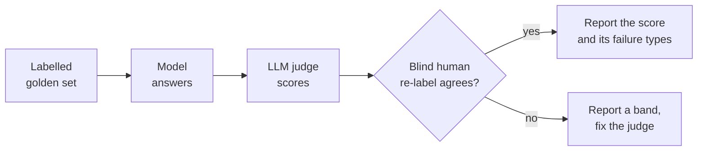

# Zoeb Nomi

**AI product manager. The question I work on: is the AI's answer right, and how would anyone know?**

At Instead, an AI-native tax research platform, I own output quality: LLM-as-judge scoring that gets checked against human labels, benchmarks across frontier models, and the retrieval corpus the answers cite. Outside work I run small evals in public on legal, tax and hiring data, and publish the misses with the wins.

> [!NOTE]
> Every number on this page comes from the repo it links to. Where a sample is small or a judge is weak, the repo says so.

## Public evals

### [CrossSource](https://github.com/zoeb-nomi/crosssource): are a legal RAG system's citations right?

v0.3 · Oct 2026 · [case study](https://www.zoebnomi.com/crosssource/) · [DOI](https://doi.org/10.5281/zenodo.21969577)

An eval harness for citation accuracy over public US case law. Before trusting the LLM judge, I re-labelled a blind sample: 15 of 15 agreed, and that pass caught a harness bug the judge had scored without noticing ([write-up](https://www.zoebnomi.com/writing/the-judge-caught-a-bug/)). On 25 questions, a stricter citation prompt moved precision from 0.981 to 0.994: three wrong-passage citations became one. Recall stayed at 0.760 because the misses were never retrieved, not wrongly answered. v0.3 adds 150 items over 45 appellate opinions (2018 to 2026) from CourtListener. Models drafted and labelled them and I adjudicated 30, so it is model-checked, not human-labelled throughout.

### [cheap-tier-legal-tax-hr](https://github.com/zoeb-nomi/cheap-tier-legal-tax-hr): where does a 10-cent model belong?

Oct 2026 · [write-up](https://www.zoebnomi.com/notes/cheap-tier-workflows/) · [findings](https://github.com/zoeb-nomi/cheap-tier-legal-tax-hr/blob/main/FINDINGS.md)

Five models, one yes/no prompt with a stated confidence, 1,414 expert-labelled items from LegalBench and Alinia's regulated-advice-bench. The cheap models land within a few points of each other on accuracy, but "sure" means very different things. Haiku 5.5 is sure (0.9 or higher) on 28 in 100 answers and right on 99 in 100 of those. The other three cheap models are sure on 92 to 93 in 100 and wrong on 15 to 16 in 100 of those. Per domain, the repo then compares one cheap model alone, a Haiku gate with Opus or a person reading the rest, and two cheap readers with Opus deciding their disagreements.

### [decisions-api-legal-quiz](https://github.com/zoeb-nomi/decisions-api-legal-quiz): can a confidence score tell you when to stop checking?

Oct 2026 · [write-up](https://www.zoebnomi.com/writing/decisions-api-legal-quiz/)

OpenAI's Decisions API returns a probability with each answer. On lawyer-labelled LegalBench questions, no safe threshold showed up: at 0.9 or higher it was 87.5% accurate on 72% of items, and at 0.99 it was 90.3% accurate on 49%. Most errors were confident "no"s on items lawyers marked "yes".

### [screener-eval](https://github.com/zoeb-nomi/screener-eval): what do LLM résumé screeners reward?

Sep 2026 · [case study](https://www.zoebnomi.com/screener-eval/) · [write-up](https://www.zoebnomi.com/writing/two-levers-that-did-not-move/)

885 scored calls: my résumé, two cheap-tier screeners, 21 real AI PM postings. Swapping every employer for a fictional one, or deleting every link, moved the fit score by about a point at most on either screener, and every interval straddles zero. Which screener read it moved the score by 22.3 points on average and flipped the majority verdict on 15 of 21 postings.

### [mirror-eval](https://github.com/zoeb-nomi/mirror-eval): what do AI search engines say about a person?

Sep 2026 · [case study](https://www.zoebnomi.com/mirror-eval/) · [write-up](https://www.zoebnomi.com/writing/eval-harness-at-my-own-reflection/)

The same method pointed at me: 332 probes a wave across ChatGPT, Claude, Perplexity and Gemini, graded against ground truth. After six source fixes and a second wave four weeks on, Perplexity went from citing my site on 13 of 63 search probes to 63 of 63. Claude cited it on zero, both waves. The LLM judges matched blind human labels on only 3 and 12 of 40 items, so everything judged is reported as a band, not a rate.

<b>Also built</b>

- **[recruiter-prompt-bank](https://github.com/zoeb-nomi/recruiter-prompt-bank)**: 239 prompts, queries and screening criteria from 79 public sources (154 quoted, 85 paraphrased, most from vendors). Only 12 to 16% ask the AI to show its evidence.
- **[tradeframe](https://github.com/zoeb-nomi/tradeframe)**: a personal trading system. Automated analysis, AI judgment and human one-tap execution on the live US book, with risk management as a first-class module. [Interactive guide](https://zoeb-nomi.github.io/tradeframe/).
- **[Portfolio](https://github.com/zoeb-nomi/Portfolio)**: the source of [zoebnomi.com](https://www.zoebnomi.com), built with Astro.

## How I use an LLM judge

A judge gets checked before it gets trusted, and where a score can be broken into failures someone can fix, I publish the breakdown. The long version: [Nobody reports the misses](https://www.zoebnomi.com/writing/nobody-reports-the-misses/).

---

Bengaluru · Open to AI PM roles · [LinkedIn](https://www.linkedin.com/in/zoebnomi) · [zoebnomi.com](https://www.zoebnomi.com) · [All writing](https://www.zoebnomi.com/writing/) · [X](https://x.com/zoeb_nomi)
